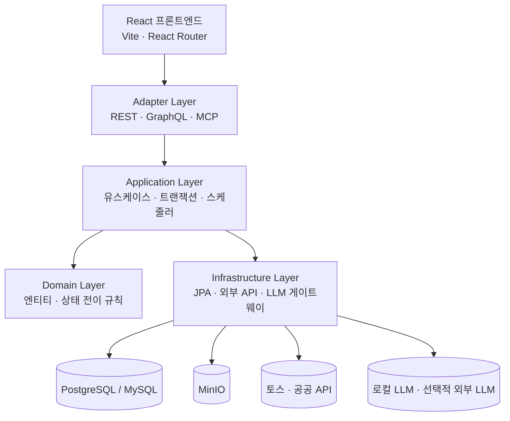

# IdolGlow (외국인 대상 K-컬처 예약·추천 플랫폼)

|                                                                                                           메인 화면 1                                                                                                           |                                                                                                           메인 화면 2                                                                                                           |
| :-----------------------------------------------------------------------------------------------------------------------------------------------------------------------------------------------------------------------------: | :-----------------------------------------------------------------------------------------------------------------------------------------------------------------------------------------------------------------------------: |
|    <a href="https://github.com/user-attachments/assets/ca2209d7-c53c-4d46-ab7b-d919db3f3d5f"></a>    |    <a href="https://github.com/user-attachments/assets/d7929859-fc89-41fc-b31b-1761da43882b"></a>    |
|                                                                                                         Glow메뉴(전체)                                                                                                          |                                                                                                        Glow메뉴(트렌드)                                                                                                         |
|   <a href="https://github.com/user-attachments/assets/a1375685-a10c-4026-a46b-597f94d95e06"></a>   |  <a href="https://github.com/user-attachments/assets/1ad7ed9f-2413-47d9-9c31-0470447d5fd6"></a>  |
|                                                                                                       Glow메뉴(glow정보)                                                                                                        |                                                                                                       Glow메뉴(최근리뷰)                                                                                                        |
| <a href="https://github.com/user-attachments/assets/7765a81b-2ea9-47ee-9dd1-c733fc3f1e2d"></a> | <a href="https://github.com/user-attachments/assets/a1664033-84fe-4676-957f-96a1271b32c5"></a> |
|                                                                                                             이벤트                                                                                                              |                                                                                                            결제통계                                                                                                             |
|      <a href="https://github.com/user-attachments/assets/4ce15820-86e0-4bca-bb90-33be01e7a145"></a>       |     <a href="https://github.com/user-attachments/assets/35de10fd-3bf1-47bf-af23-eb17082714bb"></a>      |
|                                                                                                          내 이용 통계                                                                                                           |                                                                                                             멤버십                                                                                                              |
|   <a href="https://github.com/user-attachments/assets/da63b97e-54e0-4fe9-8c3b-3c0d40b7c636"></a>    |      <a href="https://github.com/user-attachments/assets/b66365bb-021c-4850-928b-1fce2736afc6"></a>       |

<br/>

## 프로젝트 소개

**IdolGlow**는 외국인 이용자에게 K-pop 뷰티·공연·체험 상품을 설문 기반으로 추천하고,<br/>
1시간 단위 슬롯을 예약·결제하게 하는 플랫폼이다. 화면과 콘텐츠는 한국어·영어·일본어·중국어로 보여 준다.

- **예약·결제**: 슬롯 hold → 결제 → book, 실패·취소·만료 시 release. 토스 결제·정기결제·환불
- **추천**: 설문 응답 기반 상품 추천, 인기 랭킹, 위시
- **콘텐츠**: GLOW 피드, 트렌드 기사(발행 호), 공지·이벤트, 지역사회 게시판, 댓글·좋아요·공유
- **공연 메타**: 공공 API 4곳의 공연을 하나의 대표 공연으로 묶고, 애매한 건은 사람이 승인
- **다국어**: 화면 글자는 번역 파일, 저장된 콘텐츠는 번역 파이프라인으로 번역
- **운영**: 관리자 화면, 운영 변경 승인·되돌리기, 알림(SSE), 지표, Jenkins 배포

---

## 문서

- [변경 이력](CHANGELOG.md)
- API 문서: 실행 후 `/swagger-ui/index.html`
- GraphQL: 실행 후 `/graphiql`

---

## 아키텍처

### 1. IdolGlow 아키텍처



- **Adapter**: 명령·운영 REST, 조회·화면 조합 GraphQL, 관리자 AI 에이전트 MCP 도구
- **Application**: 유스케이스, 트랜잭션 경계, ShedLock 스케줄러 이용
- **Domain**: 엔티티, 값 객체, 상태 전이 규칙. 상태 필드는 엔티티 메서드로만 바꾼다
- **Infrastructure**: JPA·Querydsl 저장소, 토스·공공 API 클라이언트, LLM 게이트웨이

### 2. **주요 기술 스택**

- Kotlin 2.2, Spring Boot 4.0, JDK 25 툴체인
- Spring Security, OAuth2 Client, JWT
- Spring Data JPA, Querydsl, Flyway, PostgreSQL(개발)·MySQL(운영)
- REST, Spring GraphQL, Spring AI MCP Server, Swagger/OpenAPI
- Resilience4j, ShedLock, Micrometer, SSE
- MinIO, Jasypt, WebClient
- JUnit5, Kotest, MockK, Testcontainers, RestAssured, detekt, ktlint
- 프론트엔드: React 18, Vite, React Router, TypeScript
- 인프라: Docker Compose, Jenkins, Langfuse

---

## 주요 기능

- **사용자·인증**: OAuth2(네이버·카카오·구글), JWT Access/Refresh, Refresh Token CSRF 보호, 테스트 로그인
- **상품·옵션·예약**: 태그 기반 탐색, 슬롯 자동 생성, 슬롯 기반 예약, 시간 초과 자동 만료
- **결제**: 토스 결제 승인·웹훅·환불, 정기결제, 결제 대사 스케줄러
- **추천**: 설문 기반 추천, 인기 랭킹, 키워드 및 임베딩 기반의 근거 검색
- **콘텐츠**: GLOW 피드, 트렌드 기사, 마크다운 에디터기반의 공지·이벤트, 지역사회 게시판·신고, 댓글·좋아요·공유, 최근 본 콘텐츠
- **공연 메타**: KOPIS·세종문화회관·문화정보원·관광공사 공연 수집, 대표 공연 묶기, 매칭 검토
- **다국어**: ko·en·ja·zh 화면 전환, 콘텐츠 번역·검수·용어집·오류 신고
- **알림·운영**: SSE 알림, 관리자 대시보드, 운영 변경 요청·승인·적용·되돌리기, 감사 로그
- **GraphQL**: 상품·예약·리뷰 조회, 예약 생성·취소, 위시 토글, 리뷰 작성

---

## 폴더 구조

```
IdolGlow/
├── backend/
│   └── src/main/kotlin/com/sleekydz86/idolglow/
│       ├── global/          # 보안, 예외, 공통 설정, LLM 게이트웨이
│       ├── user/            # 인증, OAuth, 사용자
│       ├── productpackage/  # 상품, 옵션, 슬롯, 예약
│       ├── payment/         # 토스 결제, 정기결제, 환불, 대사
│       ├── eventinfo/       # 공연 메타 수집, 매칭, 공연 번역
│       ├── translation/     # 콘텐츠 번역 파이프라인
│       ├── ops/             # 운영 변경 요청·승인·되돌리기
│       ├── glowcommunity/   # 지역사회 게시판
│       ├── idolglowissue/   # 트렌드 기사
│       ├── survey/          # 설문, 추천
│       ├── groundedsearch/  # 근거 검색
│       └── ...              # notification, review, wish, comment, like 등
├── frontend/                # 사용자·관리자 화면
├── infra/                   # docker-compose(Postgres, MinIO(개발용 O, 운영 aws s3), 앱, Jenkins, Langfuse)
└── Jenkinsfile
```

각 도메인은 계층형아키텍처로 나눈다.

---

## 장점 및 차별점

- **상태 전이 정합성**: 예약·결제 상태는 엔티티 규칙으로만 바뀌고, 락 순서는 항상 예약 → 결제
- **외부 호출 분리**: 토스와 LLM 호출은 DB 트랜잭션 밖에서 하고, 결과는 다시 확인한 뒤 저장
- **틀린 데이터를 화면에 내지 않음**: 애매한 공연 매칭과 검사에 걸린 번역은 사람이 승인할 때까지 보이지 않는다
- **비용 통제**: AI는 로컬 모델이 기본이다. 외부 AI는 기본으로 꺼져 있고 하루 호출 수 상한이 있다
- **테스트**: 실제 Postgres로 동시성·정합성 테스트. 2026-11-15 기준 566개 통과

---

## 실행 방법

```bash
# 개발용 인프라
cd infra
docker compose up -d

# 앱까지 함께
docker compose --profile app up -d --build

# 운영용 ec2(Jenkins, Langfuse)
docker compose --profile jenkins --profile langfuse up -d
```

```bash
# 백엔드 단독 실행
cd backend
./gradlew bootRun

# 테스트와 정적 분석
./gradlew test detekt

# 번역 품질 평가
LLM_LOCAL_ENABLED=true ./gradlew groundedSearchEval --tests "*TranslationEvalLiveTest"
```

```bash
# 프론트엔드
cd frontend
pnpm install
pnpm dev
```

### API 테스트

```bash
# Swagger UI: http://localhost:9090/swagger-ui/index.html
# GraphiQL:   http://localhost:9090/graphiql
# 테스트 로그인: POST /auth/test/signup, POST /auth/test/login (X-Test-Auth-Key 헤더)
```

---

## 정합성과 성능

### 예약·결제

- 예약 생성은 `PENDING + slot hold`, 결제 성공은 `BOOKED + slot book`, 실패·취소·만료는 `CANCELED + slot release`
- 10명이 같은 슬롯을 동시에 예약하면 1명만 성공한다. 실제 Postgres 테스트로 확인한다
- 토스 승인·환불·웹훅 조회는 `FOR UPDATE` 락 밖에서 호출한다<br/>
  락을 쥔 채 외부 API를 기다리면 다른 요청이 줄줄이 막히기 때문이다
- 같은 웹훅이 두 번 와도 한 번만 반영한다. 응답이 끊긴 승인은 대사 스케줄러가 토스 상태를 다시 조회해 맞춘다
- 스케줄러는 ShedLock으로 서버가 여러 대여도 한 대만 돈다

### 공연 메타 매칭

- 제목을 괄호 부제·띄어쓰기·문장부호 제거 기반의 정규화하고, 기간이 겹치고 장소까지 같으면 자동으로 하나의 대표 공연으로 묶는다
- 장소만 다르면 후보, 맞는 대표 공연이 여럿이면 충돌로 보류한다<br/>
  보류된 건은 대표 공연에 붙이지 않고, 운영자가 요청 → 다른 사람 승인 → 적용해야 묶인다. 잘못 묶었으면 스냅샷으로 되돌린다
- 같은 원본이 다시 들어와도 원본 해시가 같으면 건너뛴다. 공급처 하나가 죽어도 나머지는 저장한다

### 다국어 번역

- 화면 글자는 프론트 번역 파일, 저장된 콘텐츠는 언어별로 보관한다
- 헤더 언어 → 요청 언어 → 영어 → 원문 순서로 보여 준다.
  - 한국어 요청은 번역을 찾지 않고 원문을 쓴다
- AI가 틀린 번역을 화면에 내지 않도록 다음을 거친다
  - 링크·이미지·코드·메일 주소는 자리표시로 감춰 보내고 되돌린다
  - 가격·연도·시간·전화번호가 바뀌었거나, 자리표시가 빠졌거나, 한글이 남았거나, 거절문이면 다시 번역한다. 3번 - 실패하면 노출하지 않는다
  - 용어집 위반, 길이 이상, 다른 AI 채점이 낮으면 검수 대기로 보낸다
  - 공지·이벤트·상품·기사는 관리자가 승인해야 보인다.
    - 사용자 글은 "자동 번역" 표시와 원문 보기, 번역 오류 신고를 붙인다.
    - 신고가 3건 쌓이면 숨긴다
- AI 호출은 트랜잭션 밖에서 하고, 저장할 때 원문 해시가 그대로인지 다시 확인한다.
  - 원문이 바뀌면 다시 번역 대기가 된다
- AI가 꺼져 있으면 번역은 대기로 쌓이고, 켜면 밀린 것부터 처리한다.
  - 그동안 화면에는 원문과 "번역 준비 중"을 보여 준다

### 근거 검색

- 상품, 옵션, 웹진 문단을 키워드와 임베딩으로 찾는다. 가격과 예약 가능 여부는 문단에 넣지 않는다
- 답할 때는 상품, 옵션, 슬롯 테이블이 기준이다.<br/>
  - 답의 가격이나 날짜가 그 값과 다르면 답을 거절한다<br/>
- 지역은 서울 구 이름만 통과하고, 결과가 없으면 날짜, 예산, 지역 순으로 조건을 푼다
- 임베딩은 바이트로 저장하고 유사도는 애플리케이션 메모리에서 코사인으로 계산한다<br/>
  문단이 수만 개를 넘기 전에는 이 방식으로 충분하고, 더 커지면 검색 구현만 바꾸면 된다

### 빌링키 보관

아래는 운영 정책이다. 법적 보존 기간을 정한 것은 아니다.<br/>

- 삭제 대기 동안에는 토스 재시도를 위해 암호화된 빌링키와 해시를 보관한다<br/>
- 삭제 완료 뒤에는 평문을 저장하지 않는다.<br/>
  - 암호화된 빌링키는 복구할 수 없는 표시 값으로 바꾸고, 늦은 웹훅 확인용으로 원래 해시와 삭제 시각만 남긴다.<br/>
- 삭제 거절은 확인과 수동 재시도를 위해 암호화된 키를 보관한다<br/>

---

## REST와 GraphQL을 함께 둔 이유

- **REST**: 인증, 웹훅, 관리자 운영, 파일 업로드처럼 행위 중심 API
- **GraphQL**: 상품·예약·리뷰 조회처럼 화면에 필요한 필드만 고르는 조회

`운영과 명령은 REST`, `조회와 화면 조합은 GraphQL`로 나눴다.

---

## 문제 해결

### 일반적인 문제

1. **번역이 안 보임**: `LLM_LOCAL_ENABLED`가 꺼져 있으면 번역은 대기 상태로 남는다. <br/> - 공지·상품 번역은 관리자 승인 전에는 보이지 않는다
2. **AI 호출 실패**: Resilience4j 차단기가 열리면 호출을 건너뛰고, 번역은 5분부터 2배씩 늘려 최대 3번 다시 시도한다
3. **공공 API 429**: 문화정보원 API가 초당 한도를 넘기면 잠시 호출을 멈췄다가 다시 시도한다
4. **Jenkins 테스트 메모리 부족**: 테스트 전에 Kotlin 컴파일 데몬을 내리고 테스트 힙을 1.5GB로 제한한다
5. **DB 연결 수 초과**: 테스트용 Spring 컨텍스트 캐시를 4개로 제한한다

### 로그 확인

```bash
# 앱 로그
docker compose --profile app logs -f backend

# Jenkins
docker compose --profile jenkins logs -f jenkins
```

---

## 환경 변수 예시

로컬 실행 시 최소한 아래 값을 확인한다.

- `ENCRYPT_KEY`, `JASYPT_ENCRYPTOR_PASSWORD`
- `APP_SECURITY_ALLOWED_ORIGINS`
- `JWT_SECRET`, `MOCK_PAYMENT_WEBHOOK_SECRET`, `TOSS_BILLING_CRYPTO_SECRET`
- `LLM_LOCAL_ENABLED`, `LLM_LOCAL_BASE_URL`, `LLM_LOCAL_MODEL`
- `LLM_EXTERNAL_ENABLED`, `TRANSLATION_ENABLED`

운영 환경에서는 다음도 함께 관리한다.

- `APP_AUTH_REFRESH_COOKIE_DOMAIN`
- `RESERVATION_PENDING_TIMEOUT_SECONDS`, `RESERVATION_EXPIRATION_INTERVAL_MS`
- `NOTIFICATION_SSE_TIMEOUT_MS`

---

## 지원

- **개발**: sleekydz86@naver.com
- **문서**: [API Documentation](http://localhost:9090/swagger-ui/index.html)
- **이슈**: GitHub Issues
